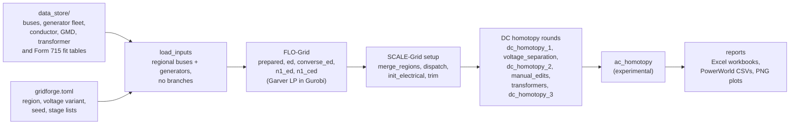

# GridForge

[](https://doi.org/10.5281/zenodo.23826484)

**A synthetic transmission-grid generator.** GridForge builds realistic,
synthetic, KCL-compliant electric transmission networks from public data
(EIA generator fleets, FERC Form 715 line statistics, census-derived loads).
It is the Python successor to the MATLAB synthetic-grid codebase from Jonathan
Snodgrass's dissertation.

Generation happens in two phases, plus an orchestrator that runs them end to end:

* **FLO-Grid** (*Flow-based Line Optimization*) — builds the network
  **topology**. It iteratively adds transmission lines using a Garver-style LP
  relaxation of transmission-expansion planning, driven by economic-dispatch
  injections, until the network reaches a target branch/bus ratio.
  *(MATLAB origin: `NationalGarverExpansion.m`.)*

* **SCALE-Grid** (*Sequential Conductor Assignment and Line Evaluation*) —
  turns topology into a full **electrical model**. It assigns voltage levels,
  conductors, impedances (R/X/B), transformer additions, and line ratings via
  sequential/homotopic DC and AC power-flow iterations until flows, angles, and
  voltages are realistic. *(MATLAB origin: `NationalConductorSizing.m`.)*

* **GridForge** — the orchestrator class that runs FLO-Grid then SCALE-Grid
  (or any subset of stages) from a single TOML config, checkpointing after
  every stage so runs are resumable.

## Status

The full pipeline runs end to end at regional scale. On the bundled regional
bus set, FLO-Grid reached a branch/bus ratio of 1.308 (9,113 branches) and
SCALE-Grid completed the dispatch → reports run (15,083 branches). The one-time
`.mat` → parquet migration (`gridforge migrate`) needs the original MATLAB
tree, which is not part of this repository; its outputs are already in
`data_store/`. See [docs/ARCHITECTURE.md](docs/ARCHITECTURE.md) for the design
and [docs/algorithms/](docs/algorithms/) for per-algorithm notes.

## Install

GridForge uses [uv](https://docs.astral.sh/uv/) and requires **Python ≥ 3.12**.

```bash
uv venv
uv pip install -e ".[dev]"     # runtime + dev (pytest, ruff)
uv run pytest
```

**Gurobi.** The LP/QP/MILP models (Garver expansion, economic dispatch) use
[`gurobipy`](https://pypi.org/project/gurobipy/). The licence bundled with the
pip package is size-limited: it covers the test suite, but full regional runs
need a full licence. Academic licences are free — install one with
`grbgetkey`.

To use pip instead of uv (Windows):

```
python -m venv .venv
.venv\Scripts\activate
pip install -e ".[dev]"
```

## Quickstart

The example config [`gridforge.toml`](gridforge.toml) drives a regional run.
Run it **from the repository root** (paths in the config are relative to the
working directory):

```bash
uv run gridforge run --config gridforge.toml
```

Every stage writes a checkpoint under `checkpoint_dir`; re-running resumes from
the newest one. FLO-Grid on the bundled regional bus set takes about 1 h 47 min
on a workstation. Progress lines start with `[gridforge HH:MM:SS]`.

Edit `gridforge.toml` to select the voltage variant, RNG seed, and which
FLO/SCALE stages to run (it replaces the hand-edited 0/1 flag blocks from the
MATLAB pipeline). Inline comments in that file document each option.

Other commands, run from the repository root:

* `uv run gridforge report --config gridforge.toml` rebuilds the reports from
  the newest SCALE-Grid checkpoint without running any stage.
* `uv run gridforge migrate --matlab-root "<path>/KCL-Compliant Grid Generator"`
  rebuilds `data_store/` from the MATLAB sources. It checks the folder first and
  replaces `data_store/` only after the new store is complete.

## How it works



The boxes from FLO-Grid onward list stage names: `prepared` to `n1_ced` for
FLO-Grid, and `merge_regions` to `reports` for SCALE-Grid. The `phases` list
under `[flo]` and the `stages` list under `[scale]` in `gridforge.toml` choose
which stages run. They always run in the order shown (`STAGES` in
[`flo/flo_grid.py`](src/gridforge/flo/flo_grid.py) and
[`scale/scale_grid.py`](src/gridforge/scale/scale_grid.py)), and `prepared`
always runs first. `merge_regions` builds a national model from the
checkpoints of the regional run folders listed in `regions_to_load` under
`[scale]`.

To redo a stage, delete its folder under `<checkpoint_dir>/flo/` or
`<checkpoint_dir>/scale/` and the folders of every later stage (for a FLO-Grid
stage, every folder under `<checkpoint_dir>/scale/`). A run picks up after the
last configured stage whose folder holds a `meta.json`; an unfinished N-1 sweep
continues from the next generator outage.

## Layout

```
GridForge/
├── src/gridforge/
│   ├── core.py         GridForge orchestrator, stage registry, CLI
│   ├── config.py       RunConfig (TOML) — replaces MATLAB flag blocks
│   ├── model.py        GridModel — THE shared data structure (buses,
│   │                   branches, generators, candidates, meta)
│   ├── solver.py       Gurobi environment / machine-sizing helpers
│   ├── io/             .mat migration, stage checkpoints, Excel/CSV writers
│   ├── data/           generator-fleet creation
│   ├── network/        topology, impedance, conductors, statistics
│   ├── dispatch/       economic dispatch (ED / converse / UCED; Gurobi QP+MILP)
│   ├── flo/            FLO-Grid: Garver LP engine + topology pipeline
│   ├── scale/          SCALE-Grid: power flow, homotopy, voltage layers,
│   │                   transformers, edits, pipeline
│   └── viz/            realism plots (matplotlib, save-to-file first)
├── data_store/         input data (parquet tables, npz arrays)
├── docs/               architecture, algorithm notes, MATLAB call graph
├── tools/              call-graph analyzer + MATLAB export script (provenance)
├── tests/              property-based test suite (pytest)
├── gridforge.toml      example run config
└── pyproject.toml      build config (hatchling) + deps
```

## Inputs and outputs

* Run configuration: a TOML file such as [`gridforge.toml`](gridforge.toml),
  read by `RunConfig.from_toml` in [`config.py`](src/gridforge/config.py).
  Sections are `[run]`, `[flo]`, `[flo.garver]`, `[scale]` and
  `[scale.homotopy_dc1]` to `[scale.homotopy_ac]`. Unknown sections and keys
  raise an error.
* `voltage_variant` picks a folder in `data_store/conductors/`:
  `230 345 kV`, `230 345 500 kV`, `230 345 500 765 kV`, `230 500 kV`,
  `345 765 kV` or `national` (" kV" is dropped and spaces become
  underscores).
* Checkpoints: `<checkpoint_dir>/flo/<stage>/` and
  `<checkpoint_dir>/scale/<stage>/`, each with `buses.parquet`,
  `branches.parquet`, `generators.parquet`, `candidates.parquet` (when
  present) and `meta.json`.
* The `reports` stage writes to `<checkpoint_dir>/reports/`:
  `FinalGarverResults.xlsx`, `NetworkLines.xlsx`, `BusList.xlsx` and
  `PowerWorldLineImport.csv`; `NetworkTransformers.xlsx`,
  `GeneratorBusMapping.xlsx` and `PowerWorldTransformerImport.csv` when the
  `transformers` stage added transformers; and PNG plots in `plots/` (bus
  degree, generator outlet capacity, and line ratings per kV compared with
  FERC Form 715 and Form 1).
* The reports use national bus numbers and give line lengths in miles
  (km / 1.61).

## Data sources

Everything the pipeline reads is in `data_store/`. The data files are licensed
under CC BY 4.0 (see [LICENSE-DATA](LICENSE-DATA)); the original sources keep
their own terms.

| Files | Contents | Original source |
|---|---|---|
| `buses_national.parquet`, `buses_regional.parquet` | Bus names, locations and loads | EIA-860 plant locations; census-derived load allocation from the EPIGRIDS project |
| `generators_national.parquet` | Generator units, limits, fuel, cost curves | EIA-860 / EIA-923 generator inventory |
| `conductors/` | Conductor catalogues per voltage variant | Standard overhead-conductor tables used in the dissertation |
| `gmd/` | Conductor-spacing (GMD) lookup tables, in feet | Dissertation tower-geometry tables |
| `params/` | Maximum line lengths, partition counts, target route lengths | Statistics from FERC Form 1 and Form 715 |
| `form715/fits.json` | Normal fits to transmission-line ratings by kV (mean, spread, sample count) | FERC Form 715 (aggregate statistics only) |
| `form715/form1_samples.parquet` | Transmission-line ratings by kV | FERC Form 1 (public) |
| `exports/XFData.parquet`, `exports/XFXR.parquet` | Typical transformer reactances and X/R ratios | Rule-of-thumb tables from the dissertation |

Per-line Form 715 ratings and generator statistics taken from actual
interconnection models are not distributed. The rating plots draw the Form 715
comparison from `form715/fits.json`, and the WECC/PJM generator comparison
plots are skipped.

## Known issues

* The `region` setting does not choose the buses. `load_inputs` in
  [`core.py`](src/gridforge/core.py) always starts from
  `data_store/buses_regional.parquet`, which holds one regional bus set
  (6,968 buses). `region` only labels the model, and the value `national`
  switches SCALE-Grid to the national line-length, partition and GMD tables.
  The example config labels the bundled set "SRTV", but its buses match the
  MISO footprint.
* FLO-Grid ignores phase names it does not know, so a typo in the `[flo]`
  `phases` list skips that phase without an error. SCALE-Grid does raise an
  error for an unknown stage name.
* `tests/test_migration.py` runs only when `GRIDFORGE_MATLAB_ROOT` points at
  the MATLAB `KCL-Compliant Grid Generator/` folder; otherwise its 9 tests are
  skipped.

## Citation

If you use GridForge or the networks it builds in published work, please cite
the GridForge paper (Snodgrass, Overbye, Lesieutre and DeMarco,
*International Journal of Electrical Power & Energy Systems*, in preparation).
The full reference is in [CITATION.cff](CITATION.cff); GitHub's "Cite this
repository" button formats it. Version 1.0.0 of the code is archived on Zenodo:
[doi:10.5281/zenodo.23826484](https://doi.org/10.5281/zenodo.23826484).

## License

* Code: MIT — see [LICENSE](LICENSE). You may use, modify, redistribute and
  sell GridForge and the networks it builds.
* Data in `data_store/`: CC BY 4.0 — see [LICENSE-DATA](LICENSE-DATA).

Copyright (c) 2026 Jonathan M. Snodgrass.

## Acknowledgment

The MATLAB code that GridForge ports to Python was developed with support from
the Advanced Research Projects Agency-Energy (ARPA-E), U.S. Department of
Energy, under Award Number DE-AR0000717 (EPIGRIDS, GRID DATA program).

**Disclaimer.** This software was prepared as an account of work sponsored by
an agency of the United States Government. Neither the United States
Government nor any agency thereof, nor any of their employees, makes any
warranty, express or implied, or assumes any legal liability or responsibility
for the accuracy, completeness, or usefulness of any information, apparatus,
product, or process disclosed, or represents that its use would not infringe
privately owned rights. Reference herein to any specific commercial product,
process, or service by trade name, trademark, manufacturer, or otherwise does
not necessarily constitute or imply its endorsement, recommendation, or
favoring by the United States Government or any agency thereof. The views and
opinions of authors expressed herein do not necessarily state or reflect those
of the United States Government or any agency thereof.

## Related repositories

* [GridCrucible](https://github.com/Snodgrass-Research-Group/GridCrucible-Public):
  the KCL-KVL generator. It carries a vendored copy of six GridForge modules in
  `src/gridcrucible/_gridforge/`.
* [GridWeld](https://github.com/Snodgrass-Research-Group/GridWeld-Public):
  builds geographically accurate test systems from public GIS data; imports
  GridForge's conductor catalogue, impedance and power-flow code.
* [LoadSmith](https://github.com/Snodgrass-Research-Group/LoadSmith-Public):
  hourly bus-level load profiles for the EPIGRIDS synthetic grids.
* [GridTemper](https://github.com/Snodgrass-Research-Group/GridTemper-Public):
  tempers a raw synthetic case into a solvable, realistic one.
